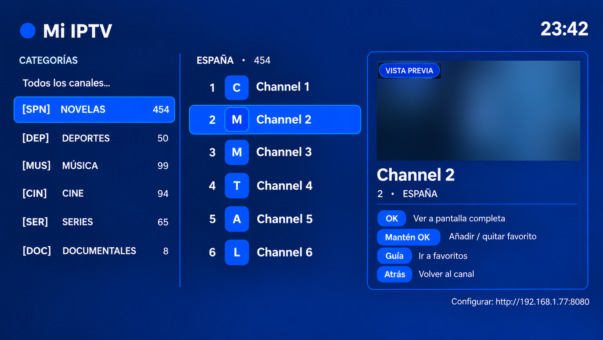
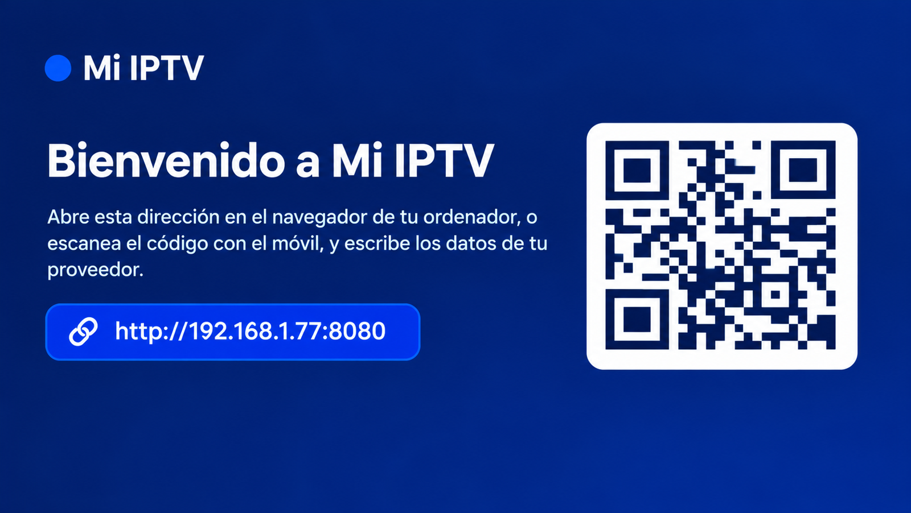
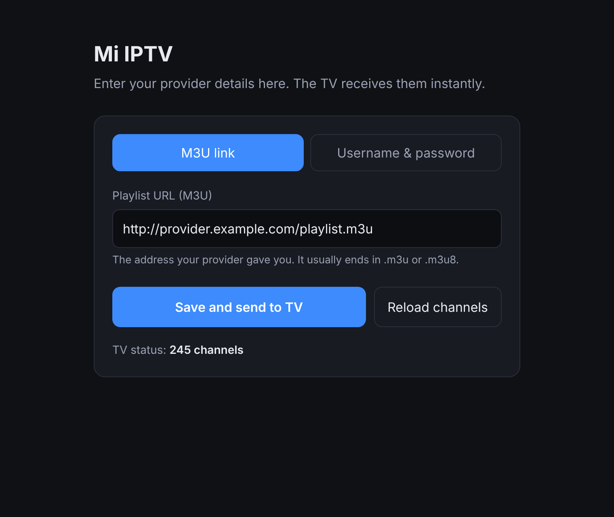
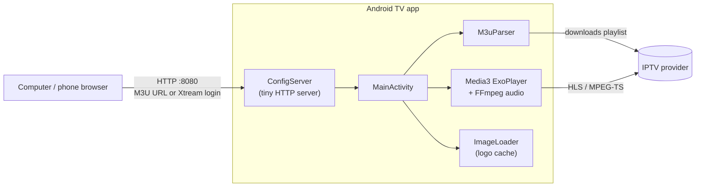

# Mi IPTV

**A lightweight IPTV player for Android TV that you set up from your computer or phone instead of typing with the remote.**

[](../../actions/workflows/build.yml)


🇪🇸 [Leer en español](README.es.md)

Typing long playlist URLs and passwords with a TV remote is painful. Mi IPTV runs a tiny web server inside the app: open the address shown on the TV (or scan the QR code), paste your M3U link or Xtream Codes credentials in your browser, and the channels appear on the TV within seconds.

<p align="center">
  
</p>
<p align="center">
  
  &nbsp;
  
</p>


## Features

- **Setup from any device on your network.** A built-in web page (and a QR code on the TV) to enter an M3U URL or Xtream Codes server, username and password.
- **Live preview.** While you browse the list, the highlighted channel plays in a small window; press OK to go full screen.
- **Favorites.** Long-press OK on any channel to add it to favorites. The remote's **Guide** button jumps straight to them.
- **iPhone remote app (optional).** [Mi IPTV Remote](ios/) finds the TV on your Wi-Fi and turns your phone into a touch remote, a keyboard to search channels, a channel list with logos, and a Share target to send links from Safari straight to the TV. The TV works exactly the same without it.
- **Designed for the remote.** Up/Down and CH+/CH− switch channels, Back never closes the app by accident (press it twice quickly to go to the TV home screen), and a banner shows the channel's logo, number and category.
- **Channel logos** loaded and cached in memory with a small custom image loader (no image library needed).
- **Dolby audio support.** Ships an FFmpeg audio decoder so AC-3 / E-AC-3 channels play with sound even on TVs whose system decoders don't expose them to apps.
- **Resilient playback.** HLS and MPEG-TS streams, automatic retry on stream errors, and an offline copy of the last playlist.
- **Bilingual.** English and Spanish, following the TV's and browser's language.

## How it works



| File | Responsibility |
|---|---|
| [`MainActivity.java`](app/src/main/java/es/mitv/iptv/MainActivity.java) | Screens, remote-control handling, favorites, preview/full-screen switching |
| [`core/ConfigServer.java`](app/src/main/java/es/mitv/iptv/core/ConfigServer.java) | Dependency-free HTTP server for the setup page and its small JSON API |
| [`core/M3uParser.java`](app/src/main/java/es/mitv/iptv/core/M3uParser.java) | M3U / `m3u_plus` parser (names, groups, logos) |
| [`core/IptvConfig.java`](app/src/main/java/es/mitv/iptv/core/IptvConfig.java) | M3U vs Xtream Codes settings and playlist URL building |
| [`core/RemoteApi.java`](app/src/main/java/es/mitv/iptv/core/RemoteApi.java) | JSON API and live event stream for the phone app, under `/api/remote/` |
| [`core/Pairing.java`](app/src/main/java/es/mitv/iptv/core/Pairing.java) | PIN pairing and per-phone tokens |
| [`RemoteDiscovery.java`](app/src/main/java/es/mitv/iptv/RemoteDiscovery.java) | Announces the TV on the network (mDNS / Bonjour) for the phone app |
| [`ImageLoader.java`](app/src/main/java/es/mitv/iptv/ImageLoader.java) | Async logo download with an in-memory LRU cache |
| [`assets/config.html`](app/src/main/assets/config.html) | The setup web page (vanilla HTML/CSS/JS, bilingual) |

The `core` package is plain Java with no Android dependencies, so it's covered by fast JVM unit tests.

### Tech stack

Java 17 · Android SDK 35 (min SDK 21) · [AndroidX Media3 / ExoPlayer](https://developer.android.com/media/media3) · [Jellyfin FFmpeg decoder for Media3](https://github.com/jellyfin/jellyfin-androidx-media) · [ZXing](https://github.com/zxing/zxing) (QR code) · JUnit 4 · GitHub Actions

## Getting started

### Download

Grab the latest APK from the [Releases](../../releases) page, or from the artifacts of the latest [Build](../../actions/workflows/build.yml) run.

### Build it yourself

Open the project in Android Studio and choose **Build → Assemble Project**, or run:

```bash
./gradlew testDebugUnitTest assembleDebug
```

The APK ends up in `app/build/outputs/apk/debug/app-debug.apk`.

### Install it on the TV

Pick whichever is easiest:

- **Over the network with Downloader.** Serve the APK from your computer (for example `jwebserver -b 0.0.0.0 -p 8000`, included with JDK 18+), then open `http://YOUR-COMPUTER-IP:8000/app-debug.apk` in the [Downloader](https://play.google.com/store/apps/details?id=com.esaba.downloader) app on the TV.
- **With ADB.** Enable developer options and USB/network debugging on the TV, then run `adb connect TV-IP:5555` and `adb install app-debug.apk`.
- **With a USB stick.** Copy the APK and open it with a file manager on the TV.

### Try it without an IPTV subscription

Use the [demo playlist](docs/demo) — fictional channels with logos, streaming open movies (Big Buck Bunny, Sintel, Tears of Steel) and public test streams. Paste this URL as the **M3U link**:

```
https://raw.githubusercontent.com/NotYourCodeES/mi-iptv/main/docs/demo/playlist.m3u
```

### Set it up

1. Open **Mi IPTV** on the TV. It shows an address such as `http://192.168.1.50:8080` and a QR code.
2. Open that address on a computer or phone on the same network.
3. Choose **M3U link** or **Username & password** (Xtream Codes), fill in your details and press **Save and send to TV**.

> The setup page only works while the app is open on the TV. On recent versions of macOS, your browser may need permission under *System Settings → Privacy & Security → Local Network* to reach devices on your network.

## Remote control

| Button | Full screen | Channel list |
|---|---|---|
| **OK** | Open the channel list | Watch the highlighted channel |
| **Hold OK** | Add / remove favorite | Add / remove favorite |
| **Up / Down**, **CH+ / CH−** | Previous / next channel | Move through the list (with live preview) |
| **Left / Right** | Open the channel list | Switch between categories and channels |
| **Guide** (or blue) | Open favorites | Open favorites |
| **Back** | Open the channel list | Return to the channel you were watching |
| **Back twice quickly** | Go to the TV home screen | Go to the TV home screen |
| **0–9** | Type a channel number | Type a channel number |
| **Last channel** | Previous channel | Previous channel |
| **Play / Pause** | Pause; press again to go back to live | — |

## iPhone remote

The optional [iPhone app](ios/) works on the same network as the TV:

- **Remote**: an Apple TV-style touch surface (swipe to move, tap for OK, hold for favorite) or classic arrows, plus channel and volume rockers that repeat while held, play/pause, mute, last channel and a number pad.
- **Keyboard**: type on the phone and the TV shows the matching channels as you type.
- **Channels**: the full list with logos, categories and favorites. Tap a channel to watch it on the TV.
- **Share**: in Safari or any app, *Share → Mi IPTV* plays a stream on the TV or loads a playlist.
- **Pairing**: the TV shows a 4-digit code the first time. Paired phones can be forgotten from the setup page.

See [`ios/README.md`](ios/README.md) to build and install it with Xcode.

## Roadmap

- [ ] Electronic program guide (EPG / XMLTV): what's on now and next
- [x] Search channels (from the iPhone app)
- [x] Jump to a channel by typing its number
- [ ] Quick switch between the last two channels
- [ ] Movies and series (VOD) for Xtream providers

## Disclaimer

Mi IPTV is a media player. It doesn't include, host or link to any channels or content. Use it only with playlists you have the right to watch, such as a paid subscription from a licensed provider, free-to-air streams or your own media server.

## License

[MIT](LICENSE)
