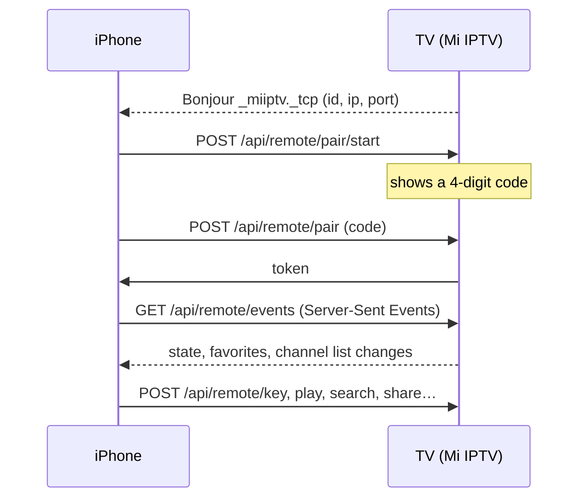

# Mi IPTV Remote (iPhone)

An optional iPhone companion for the Mi IPTV TV app: remote, keyboard, channel list and Share target. It talks to the TV over your Wi-Fi; the TV app keeps working the same without it.

SwiftUI · iOS 17+ · no third-party dependencies · English and Spanish

## Features

| Tab | What it does |
|---|---|
| **Remote** | What's on the TV, a touch surface (swipe = arrows, tap = OK, hold = favorite) or a D-pad, CH/VOL rockers that repeat while held, play/pause, mute, last channel, number pad and **Type on the TV** (live search on the TV screen) |
| **Channels** | The TV's playlist with logos, categories and favorites. Search with the iPhone keyboard, tap to watch on the TV, swipe to add a favorite |
| **More** | Opens the TV's setup page, reloads channels, sends a link to play or to use as the playlist, unpairs the phone |
| **Share extension** | *Share → Mi IPTV* from Safari or any app sends the link to the TV |

## Build and run

1. Install **Xcode 16 or newer** on your Mac.
2. Open `ios/MiIPTVRemote.xcodeproj`.
3. For both targets (**MiIPTVRemote** and **ShareExtension**), go to *Signing & Capabilities* and pick your **Team** (your Apple ID works).
4. If Xcode says the bundle identifier is taken, change `es.notyourcode.miiptv.remote` (and `.share` for the extension) to something of your own, and use the same new App Group name in both targets and in `Shared/PairedTVStore.swift`.
5. Plug in your iPhone (or pick a simulator) and press **Run**.
6. The first time, iOS asks for permission to find devices on your local network: allow it.

> **Free Apple ID:** apps signed with a free account expire after 7 days (run again from Xcode to renew), and personal teams may not support App Groups. If signing complains about App Groups, remove that capability from both targets: the app works the same, only the Share extension won't know which TV you paired.

If the project ever fails to open, you can regenerate it with [XcodeGen](https://github.com/yonaskolb/XcodeGen): `brew install xcodegen && cd ios && xcodegen`.

## How it connects

- The TV announces itself with Android's `NsdManager`; the phone browses with `NWBrowser`. You can also type the address shown on the TV.
- Pairing uses a 4-digit code shown on the TV (valid for 2 minutes). After 5 wrong codes the TV stops handing out new ones for 30 seconds, doubling each time up to 15 minutes (`pair/start` answers `429`). The phone then gets a random token that it sends as `Authorization: Bearer …`.
- The TV only answers requests addressed to an IP address or a local-network name (`.local`, `.lan`…), and rejects requests sent by other websites.
- Logos served over plain HTTP (blocked by iOS) are fetched through the TV.
- Keys sent by the phone go through the same code as the physical remote, so the TV behaves identically.

## API

All under `http://TV-IP:8080/api/remote/`. Bodies are form-encoded, responses are JSON.

| Method | Path | Auth | Purpose |
|---|---|---|---|
| GET | `info` | — | App name, API version, TV id and name |
| POST | `pair/start` | — | Show a pairing code on the TV (`device`) |
| POST | `pair` | — | Exchange the code for a token (`pin`, `device`) |
| GET | `state` | ✓ | What's on screen |
| GET | `channels` | ✓ | Channel list, categories and favorites |
| GET | `events` | ✓ | Server-Sent Events: `state`, `channels`, `favorites`, `toast` |
| GET | `logo?n=` | ✓ | A channel logo, fetched by the TV |
| POST | `key` | ✓ | `key`: `up down left right ok back menu info guide fav chup chdown last playpause volup voldown mute 0–9` |
| POST | `play` | ✓ | Watch channel `n` |
| POST | `favorite` | ✓ | Toggle (or set with `on=1/0`) channel `n` |
| POST | `search` | ✓ | Show channels matching `q` on the TV (empty clears) |
| POST | `share` | ✓ | `url`, `as=play` or `as=playlist`, optional `title` |
| POST | `reload` | ✓ | Reload the playlist |
| POST | `unpair` | ✓ | Forget this phone |
