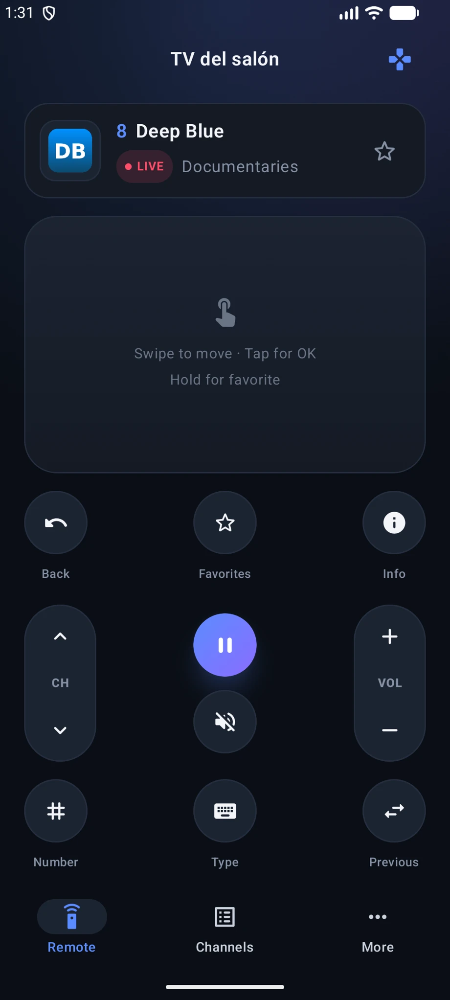
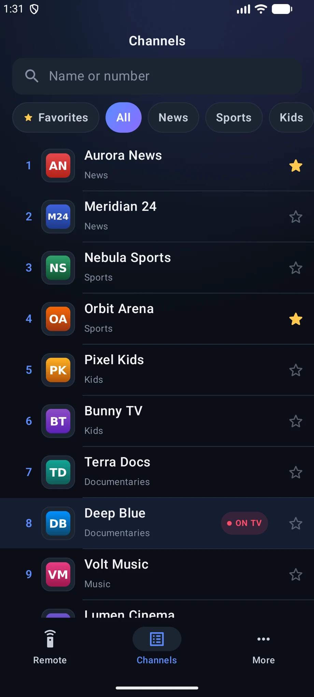

# Mi IPTV Remote (Android)

An optional Android phone companion for the Mi IPTV TV app: remote, keyboard, channel list and Share target. It's the same app as the [iPhone version](../ios/) and talks to the TV over your Wi-Fi; the TV app keeps working the same without it.

Kotlin · Jetpack Compose · Android 8+ · only AndroidX and Kotlin coroutines · English and Spanish

<p align="center">
  
  &nbsp;
  
</p>

## Features

| Tab | What it does |
|---|---|
| **Remote** | What's on the TV, a touch surface (swipe = arrows, tap = OK, hold = favorite) or a D-pad, CH/VOL rockers that repeat while held, play/pause, mute, last channel, number pad and **Type on the TV** (live search on the TV screen) |
| **Channels** | The TV's playlist with logos, categories and favorites. Search by name or number, tap to watch on the TV, tap the star to add a favorite |
| **More** | Opens the TV's setup page to change the M3U link or the Xtream account, reloads channels, sends a link to play or to use as the playlist, unpairs the phone |
| **Share** | *Share → Mi IPTV* from Chrome or any app sends the link to the TV |

Only on Android: while the app is open, the **phone's volume buttons** change the TV's volume (it can be turned off in *More*).

## Install

Download `MiIPTV-Remote-vX.Y.Z.apk` from the [Releases](https://github.com/NotYourCodeES/mi-iptv/releases) page on the phone and open it. Android asks once to allow installing apps from your browser or file manager.

The first time, open **Mi IPTV** on the TV, open the remote app on the phone, pick your TV (or type the address shown on the TV) and enter the 4-digit code the TV shows.

## Build

```bash
./gradlew :phone:assembleDebug
```

The APK ends up in `phone/build/outputs/apk/debug/phone-debug.apk`. `./gradlew :phone:testDebugUnitTest` runs the JVM tests (search, address parsing, and the HTTP and event-stream client against a fake TV).

## Release signing

Android only installs an update over an existing app when both are signed with the same key. The GitHub workflow signs the TV app and this app with a fixed key when these repository secrets exist, and with a throwaway debug key otherwise:

| Secret | Value |
|---|---|
| `MIIPTV_KEYSTORE_BASE64` | The keystore file, base64-encoded |
| `MIIPTV_KEYSTORE_PASSWORD` | Keystore password |
| `MIIPTV_KEY_ALIAS` | Key alias |
| `MIIPTV_KEY_PASSWORD` | Key password |

Local builds use the same variables (`MIIPTV_KEYSTORE` is the path to the keystore file) and fall back to the debug key.

## How it works

The code mirrors the iPhone app file by file:

| File | Responsibility |
|---|---|
| [`TvClient.kt`](src/main/java/es/mitv/iptv/remote/TvClient.kt) | HTTP calls and the Server-Sent Events stream of `/api/remote/` |
| [`Discovery.kt`](src/main/java/es/mitv/iptv/remote/Discovery.kt) | Finds `_miiptv._tcp` TVs with `NsdManager` and reads their TXT record |
| [`AppModel.kt`](src/main/java/es/mitv/iptv/remote/AppModel.kt) | State, pairing, reconnection with back-off, commands sent in order |
| [`Logic.kt`](src/main/java/es/mitv/iptv/remote/Logic.kt) | Channel search and address parsing (plain Kotlin, unit-tested) |
| [`ui/`](src/main/java/es/mitv/iptv/remote/ui) | Compose screens, same palette as the TV and iPhone apps |
| [`ShareActivity.kt`](src/main/java/es/mitv/iptv/remote/ShareActivity.kt) | The *Share → Mi IPTV* sheet |

The API is documented in [`ios/README.md`](../ios/README.md#api).
